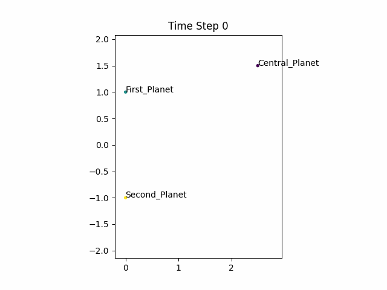
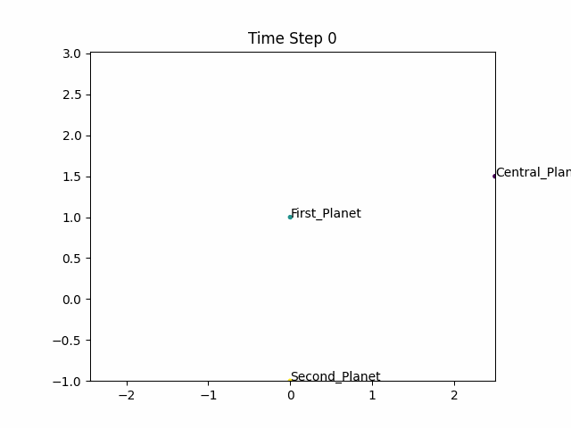
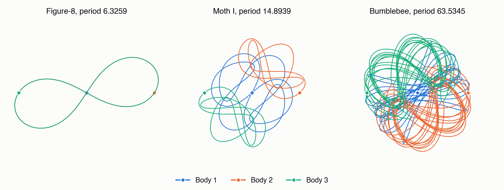
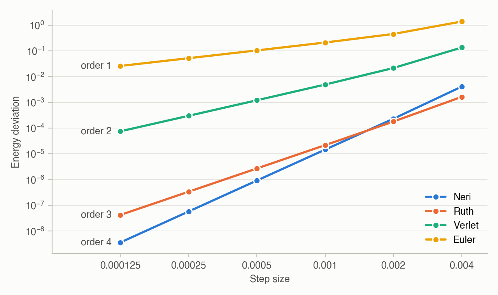
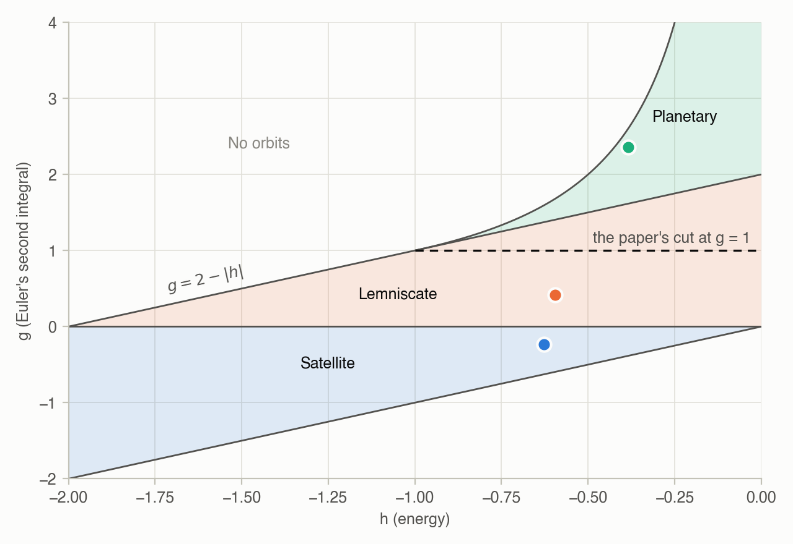
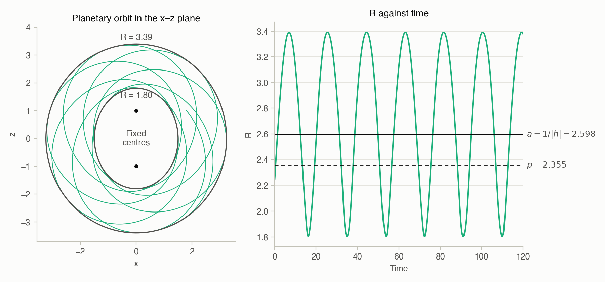

# Three_Body_Problem_Code
This repository contains the code for my summer project on the three-body problem and for the paper

> H. Yip and J. M. Smillie, "An Analysis of the Restricted Euler Problem Using Symplectic Integrators", *Edinburgh Student Journal of Science* **1**(3), 2025, [doi:10.2218/esjs.10064](https://doi.org/10.2218/esjs.10064).

<p align="center">
  
  
  
</p>
<p align="center"><em>Planetary, lemniscate and satellite orbits in the problem of two fixed centres.</em></p>

The notes and plots from the project are on [my research page](https://henry-yip.github.io/research/). For any inquiries, please do not hesitate to email me.

The integrator in this repository was rewritten in 2026 from the equations in the paper. The version I ran in 2024 was built on modules from a university computing course, which is why it was not here when the paper appeared. The rewrite reproduces the 2024 results, and the places where those results differ from the printed paper are listed below.

# Running the code
The code was tested with Python 3.13. Install the packages with `pip install -r requirements.txt`, then run the script for the result you want. The run times are from a laptop.

| Result | Command | Run time |
|---|---|---|
| Table 1 of the paper | `python reproduce_table1.py` | 1 minute |
| *g*, *h*, *p* and *η* of the three orbit types, and the semi-major axis of the planetary orbit | `python fixed_centres.py` | 30 seconds |
| The same, and save the three orbits as XYZ files | `python fixed_centres.py --xyz` | 30 seconds |
| *p*, *η* and *e* from a saved orbit, using finite differences as in the textbook verification (the time between saved points is 0.01) | `python Textbook_Verification_e_value.py` | seconds |
| Save an equal-mass orbit as an XYZ file, for example the figure-eight | `python three_body.py 0.347111 0.532728 70000 0.0001 figure_8.xyz --every 10` | seconds |
| Plot an XYZ file on the shape sphere | `python Shape_Sphere_Plotter.py` | seconds |
| Prolate spheroidal coordinates of one point | `python Prolate_Coordinates_Finder.py` | seconds |
| Keep the first N timesteps of an XYZ file | `python XYZ_Length_Modifier.py` | seconds |
| The figures in this README | `python make_figures.py` | 2 minutes |

# Figures

## Periodic three-body orbits


The paths of the three equal masses over one period of three of the orbits in Table 1, integrated with the Neri method at a step size of 0.0001. The bodies start at the dots. In the Figure-8 all three follow the same curve, so only one colour shows. After one period every body is within 0.003 of where it started.

## Comparison of the integrators


The energy deviation |*E*max − *E*min| / |*E*0| of each method on the Moth I orbit over 10 time units, for six step sizes.

## Orbit types


Where the three orbit types lie in terms of the two conserved quantities, for unit masses and *b* = 1. The solid lines follow from the separated equations for *R* and *σ*, and the dots mark the three orbits below. Orbits between the paper's cut at *g* = 1 and the line *g* = 2 − |*h*| are lemniscates.

## The planetary orbit


The planetary orbit over 120 time units. It moves in a ring between the ellipses *R* = 1.80 and *R* = 3.39 rather than around one closed ellipse, and *a* is the midpoint of the range of *R*.

# Initial conditions
For the problem of two fixed centres, the centres have unit mass and sit at (*x*, *z*) = (0, 1) and (0, −1), with *G* = 1.

| Orbit | Position (*x*, *z*) | Velocity (*v_x*, *v_z*) | *g* | *h* | *p* | *η* |
|---|---|---|---|---|---|---|
| Planetary | (1.8, 1.0) | (2/3, −0.8) | 2.355 | −0.385 | 2.355 | 0.425 |
| Lemniscate | (2.5, 1.5) | (0, −0.4) | 0.416 | −0.595 | 0.416 | 2.40 |
| Satellite | (2.5, 2.0) | (0, 0) | −0.231 | −0.627 | 0.231 | 4.34 |

These are the velocities that were actually simulated. The 2024 input files listed velocities 1.5 times larger, because a centre-of-mass correction in that code scaled the moving body's velocity by 2/3 before the run started.

The three-body orbits in Table 1 are the Figure-8, Bumblebee and Moth I orbits of Šuvakov and Dmitrašinović, with the values at the top of `reproduce_table1.py`.

# Differences from the paper
 - **Table 1.** The Bumblebee entries for the Neri and Ruth methods are both printed as 8.058 × 10⁻³. The values from the code are 8.708 × 10⁻⁴ and 8.058 × 10⁻⁴. The Figure-8 entries for those two methods are at the level of round-off, so they change slightly with the machine and the code.
 - **Euler method.** The Table 1 values were produced by updating the position first and the velocity second, whereas the paper writes the velocity first.
 - **Semi-major axis.** The paper compares the measured semi-major axis of the planetary orbit with *p* = 2.35. In the textbook those two are equal only when *e* = 0. This orbit has *e* = 0.31, so its semi-major axis is *a* = 1/|*h*| = 2.60, and *p* = *a*(1 − *e*²). It is therefore not a closed ellipse: *R* runs between 1.80 and 3.39.
 - **Orbit types.** With unit masses and *b* = 1, the boundary between lemniscate and planetary orbits is *g* = 2 − |*h*|, not *g* = 1.
 - **Project report.** The values of *e* and the *g* and *h* in the figure captions of my summer project report came from errors in the 2024 analysis code. The values of *p* and *η* in the paper are not affected.

# Important Convention
The xyz files required in most of the provided codes require the below format: 

```plaintext
3
Point = 1
Central_Planet    -6.942220069422201e-05 -0.00010654559946727201 0.0
First_Planet      1.0000347048503473 5.3272799733677604e-05 0.0
Second_Planet     -0.9999652826496529 5.32727997335944e-05 0.0
3
Point = 2
Central_Planet    -0.00013884440555377584 -0.00021309119573817583 0.0
First_Planet      1.000069397202777 0.00010654559786975359 0.0
Second_Planet     -0.999930552797223 0.00010654559786842221 0.0
3
Point = 3
Central_Planet    -0.0002082666187439927 -0.0003196367856163424 0.0
First_Planet      1.0001040770593717 0.0001598183928115413 0.0
Second_Planet     -0.9998958104406274 0.00015981839280480113 0.0
```

 - The initial 3 indicates the number of particles (always 3 in a three-body problem).
 - Each "Point" refers to a specific timestep.
 - The subsequent lines provide the coordinates corresponding to the positions of the particles at each timestep.

# Acknowledgements
I would like to express my gratitude to Prof. Jenni Smillie for generously taking the time to supervise this project.
